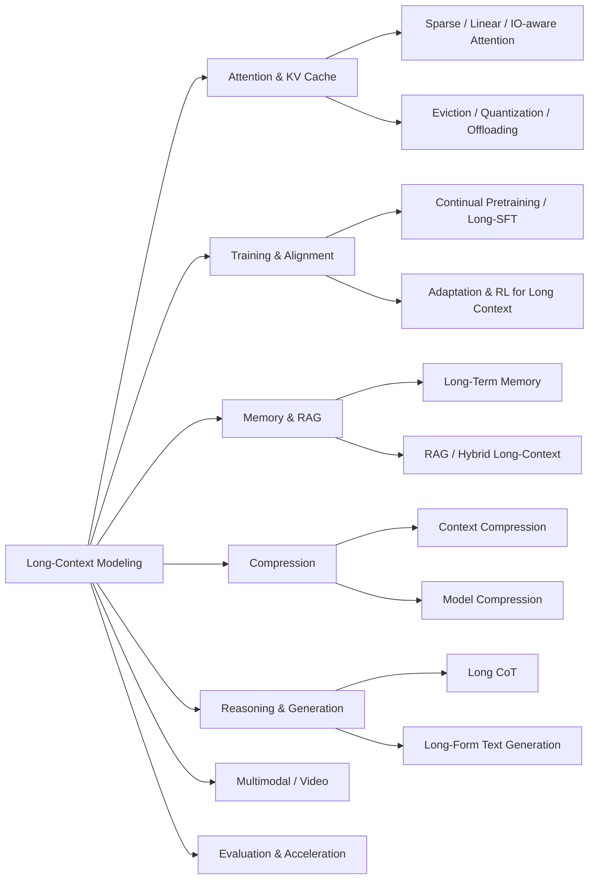

# Large Language Model Based Long Context Modeling Papers and Blogs

<!--
[](https://github.com/Xnhyacinth/Awesome-LLM-Long_Context_Modeling) [](https://opensource.org/licenses/MIT) -->
<div align="center">
 <p align="center">

<a href="https://arxiv.org/abs/2503.17407">📝 Survey Paper</a> |
<a href="#-papers">📄 Paper List</a> |
<a href="https://xnhyacinth.github.io/projects/Awesome-LCLM/">🏠 Homepage</a> |
<a href="https://www.notion.so/Huanxuan-Liao-s-Blog-6518cf95f0d54858829b042588ff88bb">📚 Notes</a> |
<a href="https://github.com/Xnhyacinth/Awesome-LLM-Long-Context-Modeling">⭐ GitHub</a>

 </p>
</div>
<div align="center">

[](https://awesome.re)
[](https://github.com/Xnhyacinth/Awesome-LLM-Long-Context-Modeling/blob/main/LICENSE)
[](https://github.com/Xnhyacinth/Awesome-LLM-Long-Context-Modeling/commits/main)
[](https://github.com/Xnhyacinth/Awesome-LLM-Long-Context-Modeling/stargazers)
[](https://github.com/Xnhyacinth/Awesome-LLM-Long-Context-Modeling/forks)
[](https://github.com/Xnhyacinth/Awesome-LLM-Long-Context-Modeling/graphs/contributors)
[](https://github.com/Xnhyacinth/Awesome-LLM-Long-Context-Modeling)
[](https://github.com/Xnhyacinth/Awesome-LLM-Long-Context-Modeling/pulls)
[](https://arxiv.org/abs/2503.17407)

</div>

This repository curates papers and blogs on long-context language modeling, covering surveys; efficient attention; KV-cache optimization; recurrent transformers and state-space models; position encoding & length extrapolation; long-context training; long-term memory; retrieval-augmented generation; in-context learning; context and model compression; long reasoning (long CoT); long video & image; long-horizon agents; long-text generation; inference acceleration; benchmarks & evaluation; and technical reports.

🔥 Must-read papers for LLM-based Long Context Modeling.

🔥⚡🔥 Thanks for all the great contributors on GitHub!

🚀🤝🚀 I have the privilege of joining [**LCLM-Horizon**] and collaborating with them on providing a very complete and comprehensive scholarly survey \([A Comprehensive Survey on Long Context Language Modeling](https://arxiv.org/abs/2503.17407)\) and repository \([A-Comprehensive-Survey-For-Long-Context-Language-Modeling](https://github.com/LCLM-Horizon/A-Comprehensive-Survey-For-Long-Context-Language-Modeling)\) dedicated to **Long Context Language Modeling**. I look forward to collaborating with them to advance research and deepen understanding in this area!

<!--Thanks to [**LCLM-Horizon**]\([A-Comprehensive-Survey-For-Long-Context-Language-Modeling](https://github.com/LCLM-Horizon/A-Comprehensive-Survey-For-Long-Context-Language-Modeling)\) for providing a very complete and comprehensive scholarly survey \([A Comprehensive Survey on Long Context Language Modeling]()\) of the field of Long Context Language Modeling. I have joined them and we will collaborate to further research and understanding in this area!-->

<details>
<summary><b>Taxonomy at a glance</b></summary>



</details>

If you find our repository and survey useful for your research, please consider citing the following paper:

```bibtex
@article{liu2025comprehensive,
  title={A Comprehensive Survey on Long Context Language Modeling},
  author={Liu, Jiaheng and Zhu, Dawei and Bai, Zhiqi and He, Yancheng and Liao, Huanxuan and Que, Haoran and Wang, Zekun and Zhang, Chenchen and Zhang, Ge and Zhang, Jiebin and others},
  journal={arXiv preprint arXiv:2503.17407},
  year={2025}
}
```

## Contents

- [📢 News](#-news)
  - [Week Papers](#week-papers)
  - [Month Papers](#month-papers)
- [📜 Papers](#-papers)
  - [1. Survey Papers](papers/01-survey.md)
  - [2. Efficient Attention](papers/02-efficient-attention.md)
  - [3. KV-Cache Optimization](papers/03-kv-cache.md)
  - [4. Recurrent Transformers](papers/04-recurrent-transformers.md)
  - [5. State Space Models & Hybrids](papers/05-state-space-models.md)
  - [6. Position Encoding & Length Extrapolation](papers/06-position-encoding.md)
  - [7. Long-Context Training](papers/07-long-context-training.md)
  - [8. Long-Term Memory](papers/08-long-term-memory.md)
  - [9. Retrieval-Augmented Generation](papers/09-retrieval-augmented-generation.md)
  - [10. In-Context Learning (Many-shot / Long-ICL)](papers/10-in-context-learning.md)
  - [11. Context Compression](papers/11-context-compression.md)
  - [12. Model Compression for Long Context](papers/12-model-compression.md)
  - [13. Long Reasoning (Long CoT)](papers/13-long-reasoning.md)
  - [14. Long Video & Image](papers/14-long-video-image.md)
  - [15. Long-Horizon Agents](papers/15-long-horizon-agents.md)
  - [16. Long-form Text Generation](papers/16-long-form-text-generation.md)
  - [17. Inference Acceleration & Serving](papers/17-inference-acceleration.md)
  - [18. Benchmarks & Evaluation](papers/18-benchmarks.md)
  - [19. Technical Reports (Long-Context Models)](papers/19-technical-reports.md)
  - [20. Blogs & Tutorials](papers/20-blogs.md)
- [Acknowledgements](#acknowledgements)
  - [Contributors](#contributors)
  - [Star History](#star-history)

## 📢 News

### Week Papers

- **[2026.10.21]**
  - Paper: [Don't Stop Long-Context Continual Pre-Training Too Early: An Empirical Scaling Law](https://arxiv.org/abs/2610.29352) [](https://github.com/thunlp/dont-stop-lccp)
  - Paper: [Uni-Mem: Learning a Long-Horizon Agentic Memory Manager with Unified Online Policy Optimization](https://arxiv.org/abs/2610.29671)
  - Paper: [LongZero: Enhancing Long-Context Reasoning in LLMs from Zero Data](https://arxiv.org/abs/2610.30132) [](https://github.com/zhennan1/LongZero)
  - Paper: [Cache Locally, Recompute Selectively for Streaming Video Understanding](https://arxiv.org/abs/2610.29229)

- **[2026.10.20]**
  - Paper: [Scan or Index? Large Evidence Coverage, Answer Quality, and Cost in Long-Document RAG](https://arxiv.org/abs/2610.28957)
  - Paper: [Cache Engineering for Agents](https://arxiv.org/abs/2610.28577) [](https://github.com/thu-nics/AKV)

- **[2026.10.19]**
  - Paper: [KEEP-Bench: Evaluating Evidence Preservation in Context Compression](https://arxiv.org/abs/2610.26827)
  - Paper: [LEAPS: Long-context Evaluation of Adaptive Pattern Learning and State Tracking](https://arxiv.org/abs/2610.25919)
  - Paper: [TokenGate: Adapting LLMs for Fast and Memory-Efficient Prefill with Learned Token Pruning](https://arxiv.org/abs/2610.26754) [](https://github.com/tokengate-models/TokenGate)
  - Paper: [Kronecker Delta Rule for Long Context Linear Attention](https://arxiv.org/abs/2610.26834) [](https://github.com/NX-AI/KronLSTM)

- **[2026.10.18]**
  - Paper: [DiaLong: Benchmarking Reminiscence in Long-Context Dialogues](https://arxiv.org/abs/2610.25463)
  - Paper: [The Bottleneck Is Retrieval, Not Reading: Diagnosing Evidence-Based Generation with RAG for Long Context Question Answering](https://arxiv.org/abs/2610.26951) [](https://github.com/debobanerjee/LC-EBG)

- **[2026.10.17]**
  - Paper: [TideKV: Delayed KV Eviction via Layer-Wise Chunked Prefill for Memory-Efficient Long-Context LLM Inference](https://arxiv.org/abs/2610.24499)

- **[2026.10.16]**
  - Paper: [Towards Looped Models Done Right, Part I: Topology, Input Injection, Recurrent-State Design](https://arxiv.org/abs/2610.23036) [](https://github.com/ifm-ai/xllm-loop)
  - Paper: [DLite: History-free Speculative Decoding for Agentic AI](https://arxiv.org/abs/2610.23787)

- **[2026.10.15]**
  - Paper: [GACC-Bench: Benchmarking Goal-Adaptive Context Compression Ability across Large Language Models](https://arxiv.org/abs/2610.21893)
  - Paper: [Beyond Context Length: Characterising the Difficulty of Long-Context Reasoning](https://arxiv.org/abs/2610.22067)
  - Paper: [DropKV: Decoupling Residual-Output Perturbation for Near-Optimal KV-Cache Eviction](https://arxiv.org/abs/2610.22130) [](https://github.com/AozhongZhang/DropKV)
  - Paper: [Librarian Agents: Training LLMs to Curate Long-Context Workspaces that Anticipate Future Queries](https://arxiv.org/abs/2610.22273)

- **[2026.10.14]**
  - Paper: [DeltaStreamer: Towards Human-Like Agentic Streaming Video Understanding](https://arxiv.org/abs/2610.19849)
  - Paper: [Beyond State Capacity: Why Retrieval Breaks in Mamba](https://arxiv.org/abs/2610.19709) [](https://github.com/schwartz-lab-NLP/beyond_state_capacity)
  - Paper: [Cortex: Consolidating Context into Parametric Memory](https://arxiv.org/abs/2610.20399)
  - Paper: [Prune the Summary, Not the History: Source-Judged Compaction for Long-Horizon Agents](https://arxiv.org/abs/2610.20927) [](https://github.com/GuanghuiMin/sjc)
  - Paper: [BizAgentBench: Unveiling Hidden Challenges in Deploying Long-Horizon Agents for Real-World Business](https://arxiv.org/abs/2610.20424) [](https://github.com/ant-intl/BizAgentBench)

- **[2026.10.13]**
  - Paper: [VideoJev: System One Model for Video Understanding and Interaction](https://arxiv.org/abs/2610.18615) [](https://github.com/MCG-NJU/VideoJev) [](https://mcg-nju.github.io/VideoJev/)
  - Paper: [DoubtLess: Training-Free Contrastive Decoding for Efficient Reasoning](https://arxiv.org/abs/2610.18862) [](https://github.com/leoluolol/DoubtLess)
  - Paper: [Pack Light, CarryOn: Building Object-Oriented Context for Long-Horizon Agents](https://arxiv.org/abs/2610.18784) [](https://github.com/Ethannju/carryon) [](https://ethannju.github.io/carryon)
  - Paper: [FrameScout: Scouting Query-Relevant Frames for Long Video Understanding](https://arxiv.org/abs/2610.23975) [](https://github.com/Hubert-1102/FrameScout)
  - Paper: [Joint Subspace Sparse Attention for Efficient Long-Context Decoding](https://arxiv.org/abs/2610.19026)

- **[2026.10.12]**
  - Paper: [FreeSolo: Linear-time Sparse Attention with Zero-Shot Length Extrapolation](https://arxiv.org/abs/2610.17191) [](https://github.com/zekun-shi/freesolo)
  - Paper: [Elephant in the Fridge: Constant-Memory Frame Packing for Long Video Understanding](https://arxiv.org/abs/2610.16118) [](https://github.com/ZelD0n/framepack-U) [](https://zeld0n.github.io/framepack-U/)

- **[2026.10.11]**
  - Paper: [History Replays Itself: Unleashing Long-Context Capability in Linear Attention](https://arxiv.org/abs/2610.15715) [](https://nanboli.github.io/notebank-page)
  - Paper: [Apertus 1.5: From Open Text Models to Open Multimodal Reasoners](https://arxiv.org/abs/2610.15542)

- **[2026.10.10]**
  - Paper: [SPARE: Shared Perception and Adaptive Retrieval of Evidence for Streaming Video Understanding](https://arxiv.org/abs/2610.14671)
  - Paper: [SAFE-KV: Causal Suffix Repair for Behavior-Preserving Non-Prefix KV Cache Reuse in RAG](https://arxiv.org/abs/2610.15186) [](https://github.com/XingjianZhang-dev/safe-kv)
  - Paper: [KV4-RL: Unlocking Faster Asynchronous Rollouts for RLVR with INT4 KV Cache Quantization](https://arxiv.org/abs/2610.14448)

- **[2026.10.09]**
  - Paper: [Constructing Pareto Frontiers of Optimal Reasoning Termination Methods for Overthinking in Reasoning Models](https://arxiv.org/abs/2610.13570)
  - Paper: [REMORY: Learning Residual Memory for Context Compaction](https://arxiv.org/abs/2610.11287) [](https://github.com/1ring2rta/Remory)

- **[2026.10.08]**
  - Paper: [FastBench: Can Streaming VLMs Perceive High-Dynamic Real-World Streams?](https://arxiv.org/abs/2610.12427)
  - Paper: [From Retrieval to Reconstruction: Constructing Evolvable Cognitive Memory for Long-Term Dialogue](https://arxiv.org/abs/2610.11314) [](https://github.com/Silent-Rain02/CogMem)
  - Paper: [Thinking Inertia: LLMs Keep Thinking When Told Not To](https://arxiv.org/abs/2610.11765) [](https://github.com/thinking-inertia/code) [](https://thinking-inertia.github.io)
  - Paper: [V-CoLA: Vision Token Compression with Linear Attention](https://arxiv.org/abs/2610.11251)

### Month Papers

<details><summary>Month Papers</summary>

- **[2026.10.07]**
  - Paper: [VideoEvolve: Co-Evolving Memory and Retrieval for Long Video Understanding](https://arxiv.org/abs/2610.10183)
  - Paper: [Mechanics of Long-Context Hybrid Models Part 1.1: From Hybrid Attention to Hybrid Position](https://arxiv.org/abs/2610.10114)

- **[2026.10.06]**
  - Paper: [UNREAL: Unifying Retrieval and Long-Context with a Single Model](https://arxiv.org/abs/2610.08463)

- **[2026.10.05]**
  - Paper: [ReMem: Streaming Video Understanding With Long Context Retention](https://arxiv.org/abs/2610.05940)
  - Paper: [Behavior-Preserving KV Cache Compression](https://arxiv.org/abs/2610.06479)

- **[2026.10.03]**
  - Paper: [WavePrune: One period is often enough for RoPE](https://arxiv.org/abs/2610.06963) [](https://github.com/ducatiqwq/WavePrune)
  - Paper: [Rethinking Long-Video Efficiency: A Joint Allocation Perspective on Frames, Pixels, and Front-End Latency](https://arxiv.org/abs/2610.04318)

- **[2026.10.02]**
  - Paper: [LongSocialBench: Do Long-Context LLMs Understand Online Discussion Threads?](https://arxiv.org/abs/2610.04118)

- **[2026.10.01]**
  - Paper: [OneStreamer: Unifying Perception, Memory, and Proactive Response in Streaming Video Interaction](https://arxiv.org/abs/2610.01762) [](https://github.com/MCG-NJU/OneStreamer) [](https://mcg-nju.github.io/OneStreamer/)
  - Paper: [How Much Can Language Models Gain from Test-Time Computation?](https://arxiv.org/abs/2610.01110)

- **[2026.09.30]**
  - Paper: [ReLiveGym: Evaluating Long-Lived Agents over Weeks of Replayed Reality](https://arxiv.org/abs/2610.00710) [](https://github.com/SaharaLabsAI/ReLiveGym)
  - Paper: [RoPE at the End of Its Rope? Theory, Diagnosis, and Mitigation of Long-Context Failures](https://arxiv.org/abs/2609.39929)
  - Paper: [Persistent Context Graphs for Efficient Memory Compaction in LLM Agents](https://arxiv.org/abs/2609.40118)
  - Paper: [SparseEngine: Sparse-First Inference Engine](https://arxiv.org/abs/2609.39068) [](https://github.com/CURRENTF/SparseEngine)
  - Paper: [Switching Linear Attention](https://arxiv.org/abs/2609.39034) [](https://github.com/lindermanlab/switching-linear-attention)

- **[2026.09.29]**
  - Paper: [LongHarness Bench: Stress-Testing Language Model Harnesses for Long-Context Reasoning](https://arxiv.org/abs/2609.38137)
  - Paper: [Triadic Linear Attention: Three-Dimensional Recurrent States for Long-Context Sequence Modeling](https://arxiv.org/abs/2609.36529) [](https://github.com/OliverSieberling/TriadicLinearAttention)
  - Paper: [PolyOCR-Venus: Unified OCR Foundation Models for Text-Centric Visual Intelligence](https://arxiv.org/abs/2609.37712)
  - Paper: [Beyond the Timeline: Augmenting Long-Video Memory with Grounded Entity Biographies](https://arxiv.org/abs/2609.38155) [](https://github.com/rhfeiyang/GEB)
  - Paper: [WUSH-KV: KV Cache Quantization with Data-Adaptive Transforms](https://arxiv.org/abs/2609.38121)
  - Paper: [APM-Bench: Benchmarking Cross-session Persistent Memory for Egocentric Streaming Video Assistants](https://arxiv.org/abs/2609.37559) [](https://github.com/Jianguo-Huang11/APM-Bench)
  - Paper: [VideoLoop: Looped Working Memory Against Semantic Thrashing in Long-Form Video Agents](https://arxiv.org/abs/2609.38119)

- **[2026.09.28]**
  - Paper: [Scaling Long-Form Story Generation via Narrative State Tracking](https://arxiv.org/abs/2609.35759) [](https://github.com/zhennan1/NstAgent)
  - Paper: [RoPE is Dead, Long Live RoPE: Towards Scalable Data-aware Positional Encodings](https://arxiv.org/abs/2609.34556)
  - Paper: [Improving Test-Time Scaling with Adaptive Looped Transformers](https://arxiv.org/abs/2609.35748) [](https://github.com/thu-nics/TaH) [](https://fuvty.github.io/thinking_yard_project_page/projects/tah2/)
  - Paper: [Fractional State Space Transition for Long Sequence Modeling](https://arxiv.org/abs/2609.36314) [](https://github.com/anasiri/frac-ssm)
  - Paper: [Beyond Selection: Token Parameterization for Extreme Visual Token Compression](https://arxiv.org/abs/2609.35232) [](https://github.com/zrrraa/Braco)
  - Paper: [Periodic Weak Spots: Phase Sensitivity from Chunked KV-Cache Compression](https://arxiv.org/abs/2609.36322)
  - Paper: [Xiaomi-OCR-0 Technical Report](https://arxiv.org/abs/2609.36136)

- **[2026.09.26]**
  - Paper: [Shared Worlds, Private Minds: Structured Memory for Long-Form Writing as World Creation](https://arxiv.org/abs/2609.32401)
  - Paper: [Prefill-Free Cross-Family KV Cache Transfer for Heterogeneous Multi-Agent LLMs](https://arxiv.org/abs/2609.32259)
  - Paper: [MassAlloc Attention: Let Attention Allocate Its Own Compute](https://arxiv.org/abs/2609.32712)
  - Paper: [DoSA: Dots Sparse Attention](https://arxiv.org/abs/2610.13990)

- **[2026.09.25]**
  - Paper: [Highlight-Then-Summarize: Learning to Compress Evidence for Long-Context Understanding](https://arxiv.org/abs/2609.31382) [](https://github.com/X-Luffy/Highlight-Then-Summarize)
  - Paper: [Block Sparse Attention with Log-Linear Complexity](https://arxiv.org/abs/2609.31093)

- **[2026.09.24]**
  - Paper: [MILO: Efficient Many-shot In-Context Learning with Block-wise Low-rank Compression](https://arxiv.org/abs/2609.29913)

- **[2026.09.23]**
  - Paper: [KITE: KV-Invariant Transformer Expansion for Efficient Agentic LLM Scaling](https://arxiv.org/abs/2609.27294)

- **[2026.09.22]**
  - Paper: [Compressing Long Context into Answer-Aligned Memory Embeddings for LLM Inference](https://arxiv.org/abs/2609.25537)
  - Paper: [CompKV: Compensation-Aware KV Selection for Long-Context LLM Inference](https://arxiv.org/abs/2609.26300)
  - Paper: [Knowledge Pull Requests for Continual Document Authoring](https://arxiv.org/abs/2609.26634) [](https://github.com/alexmartin1722/kpr)
  - Paper: [Qwen3.8-Omni: Towards Native Omni-Modal Agents](https://arxiv.org/abs/2609.25611)
  - Paper: [Disaggregated Quantization: Specializing LLM Prefill and Decode](https://arxiv.org/abs/2609.26333)

- **[2026.09.21]**
  - Paper: [Jev-Mem: System-One-Controlled Agentic Memory for Efficient AI Agents](https://arxiv.org/abs/2609.23986)
  - Paper: [DolphinBench: Mapping the Pareto Frontier of Agent Memory](https://arxiv.org/abs/2609.24971)

- **[2026.09.20]**
  - Paper: [RPMem: Learning Long-Term Recurrent Parametric Memory Across Sessions for LLM Agents](https://arxiv.org/abs/2609.23466)
  - Paper: [Global Ranks Survive, Selected Heads Shift: BOS-Sink Topology under 4-bit Weight-Only Quantization](https://arxiv.org/abs/2609.23585)

- **[2026.09.17]**
  - Paper: [DeepSeek-V4.1-Flash: Pushing the Limits of KV Cache Compression](https://arxiv.org/abs/2609.19969)
  - Paper: [When2Think: Learning When and How Much to Reason](https://arxiv.org/abs/2609.19671) [](https://github.com/JJunShim/When2Think)
  - Paper: [When EOS Tokens Disagree: Understanding Length Inflation in On-Policy Distillation](https://arxiv.org/abs/2609.20511) [](https://github.com/UNCSciML/opd-eos)

- **[2026.09.16]**
  - Paper: [ASPIRE: Asynchronous Batched Self-Speculative Decoding for Long-Context LLM Inference](https://arxiv.org/abs/2609.17943)

- **[2026.09.13]**
  - Paper: [SpectralShift: Effective Context Window Extension of Gated DeltaNet via Spectral Reparameterization](https://arxiv.org/abs/2609.14320) [](https://github.com/RUCAIBox/GDN-SpectralShift)

- **[2026.09.11]**
  - Paper: [SAS: Simple Attention Sparsification via End-to-End Optimization of Context Ranking](https://arxiv.org/abs/2609.13141) [](https://github.com/Tencent-Hunyuan/Simple-Attention-Sparsification)

- **[2026.09.10]**
  - Paper: [FlexComp: One Model for Every Ratio in Context Compression](https://arxiv.org/abs/2609.11192)

- **[2026.09.07]**
  - Paper: [On the Recall Scaling Laws in Mamba: A Theoretical and Mechanistic Study via Hashing](https://arxiv.org/abs/2609.07681) [](https://github.com/yuvalko1/mamba-recall-scaling-laws)
  - Paper: [Online Draft Co-Training for Speculative Decoding in Large-Scale, Long-Context RL Post-Training](https://arxiv.org/abs/2609.07108) [](https://github.com/NVIDIA-NeMo/RL)
  - Paper: [ReactVAU: A Slow-Fast Decoupled Framework for Streaming Video Anomaly Understanding](https://arxiv.org/abs/2609.07941)

- **[2026.09.06]**
  - Paper: [PARSER: Read in Parallel, Reason in Depth for Long-Context LLM Agents](https://arxiv.org/abs/2609.06702)

- **[2026.09.04]**
  - Paper: [BeaconKV: Key-Value Cache Compression Guided by Beacon Queries for Efficient Large Reasoning Model Inference](https://arxiv.org/abs/2609.04971) [](https://github.com/aiha-lab/BeaconKV)

- **[2026.09.03]**
  - Paper: [Why Gated DeltaNet Survives 4-Bit Quantization: NVFP4 W4A4 for the Recurrent Half of a Hybrid 27B LLM](https://arxiv.org/abs/2609.04098)
  - Paper: [Beyond Retrieval: Progressive Latent Memory Evolution for Streaming Video Understanding](https://arxiv.org/abs/2609.04131)
  - Paper: [Random Attention: Rethinking KV Cache Eviction for Efficient Reasoning](https://arxiv.org/abs/2609.03430) [](https://github.com/SalesforceAIResearch/Random-Attention) [](https://arthur-heng.github.io/Random-Attention-page/)

- **[2026.09.02]**
  - Paper: [Language Models Can Control Their Own Attention](https://arxiv.org/abs/2609.02737) [](https://github.com/itsnamgyu/declarative-attention)

- **[2026.09.01]**
  - Paper: [Instella-MoE Technical Report](https://arxiv.org/abs/2609.00791)
  - Paper: [Compile, Don't Memorize: A Context Compilation Architecture (CCA) for In-Context Learning](https://arxiv.org/abs/2609.00759) [](https://github.com/TonyQJH/cca-emnlp2026)
  - Paper: [LatentPress: Context Compression Beyond Text and Vision](https://arxiv.org/abs/2609.01507) [](https://github.com/HJSang/LatentPress)

- **[2026.08.28]**
  - Paper: [Sliding-window beats linear attention](https://arxiv.org/abs/2608.28444)
  - Paper: [ContextPilot: Teaching Agents for Proactive Context Management via Fine-grained RL](https://arxiv.org/abs/2608.28476) [](https://github.com/Tencent/ContextPilot) [](https://tencent.github.io/ContextPilot/)

</details>

## 📜 Papers

Paper entries live under [`papers/`](papers/) so this README stays under GitHub's homepage size limit.
For an interactive chapter reader (search + in-page paper cards), open the
[project homepage](https://xnhyacinth.github.io/projects/Awesome-LCLM/).

<details open>
<summary><b>Attention, recurrence &amp; systems</b></summary>

- [1. Survey Papers](papers/01-survey.md)
- [2. Efficient Attention](papers/02-efficient-attention.md)
- [3. KV-Cache Optimization](papers/03-kv-cache.md)
- [4. Recurrent Transformers](papers/04-recurrent-transformers.md)
- [5. State Space Models &amp; Hybrids](papers/05-state-space-models.md)
- [17. Inference Acceleration &amp; Serving](papers/17-inference-acceleration.md)

</details>

<details open>
<summary><b>Training, position &amp; memory</b></summary>

- [6. Position Encoding &amp; Length Extrapolation](papers/06-position-encoding.md)
- [7. Long-Context Training](papers/07-long-context-training.md)
- [8. Long-Term Memory](papers/08-long-term-memory.md)
- [9. Retrieval-Augmented Generation](papers/09-retrieval-augmented-generation.md)
- [10. In-Context Learning (Many-shot / Long-ICL)](papers/10-in-context-learning.md)

</details>

<details open>
<summary><b>Compression, reasoning &amp; multimodal</b></summary>

- [11. Context Compression](papers/11-context-compression.md)
- [12. Model Compression for Long Context](papers/12-model-compression.md)
- [13. Long Reasoning (Long CoT)](papers/13-long-reasoning.md)
- [14. Long Video &amp; Image](papers/14-long-video-image.md)
- [15. Long-Horizon Agents](papers/15-long-horizon-agents.md)
- [16. Long-form Text Generation](papers/16-long-form-text-generation.md)

</details>

<details open>
<summary><b>Evaluation &amp; reports</b></summary>

- [18. Benchmarks &amp; Evaluation](papers/18-benchmarks.md)
- [19. Technical Reports (Long-Context Models)](papers/19-technical-reports.md)
- [20. Blogs &amp; Tutorials](papers/20-blogs.md)

</details>

## Acknowledgements

Please contact me if I miss your names in the list, I will add you back ASAP!

### Contributors

<a href="https://github.com/Xnhyacinth/Awesome-LLM-Long-Context-Modeling/graphs/contributors">
  
</a>

### Star History

[](https://github.com/Xnhyacinth/Awesome-LLM-Long-Context-Modeling/stargazers)
