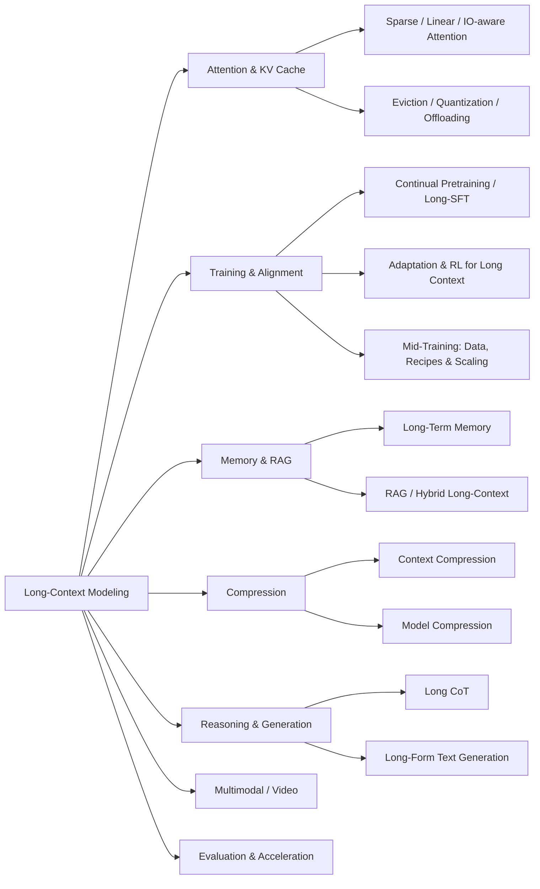

# Large Language Model Based Long Context Modeling Papers and Blogs

<!--
[](https://github.com/Xnhyacinth/Awesome-LLM-Long_Context_Modeling) [](https://opensource.org/licenses/MIT) -->
<div align="center">
 <p align="center">

<a href="https://arxiv.org/abs/2503.17407">📝 Survey Paper</a> |
<a href="#-papers">📄 Paper List</a> |
<a href="https://xnhyacinth.github.io/projects/Awesome-LCLM/">🏠 Homepage</a> |
<a href="https://www.notion.so/Huanxuan-Liao-s-Blog-6518cf95f0d54858829b042588ff88bb">📚 Notes</a> |
<a href="https://github.com/Xnhyacinth/Awesome-LLM-Long-Context-Modeling">⭐ GitHub</a>

 </p>
</div>
<div align="center">

[](https://awesome.re)
[](https://github.com/Xnhyacinth/Awesome-LLM-Long-Context-Modeling/blob/main/LICENSE)
[](https://github.com/Xnhyacinth/Awesome-LLM-Long-Context-Modeling/commits/main)
[](https://github.com/Xnhyacinth/Awesome-LLM-Long-Context-Modeling/stargazers)
[](https://github.com/Xnhyacinth/Awesome-LLM-Long-Context-Modeling/forks)
[](https://github.com/Xnhyacinth/Awesome-LLM-Long-Context-Modeling/graphs/contributors)
[](https://github.com/Xnhyacinth/Awesome-LLM-Long-Context-Modeling)
[](https://github.com/Xnhyacinth/Awesome-LLM-Long-Context-Modeling/pulls)
[](https://arxiv.org/abs/2503.17407)

</div>

This repository curates papers and blogs on long-context language modeling, covering surveys; efficient attention; KV-cache optimization; recurrent transformers and state-space models; position encoding & length extrapolation; long-context training and mid-training; long-term memory; retrieval-augmented generation; in-context learning; context and model compression; long reasoning (long CoT); long video & image; long-horizon agents; long-text generation; inference acceleration; benchmarks & evaluation; and technical reports.

🔥 Must-read papers for LLM-based Long Context Modeling.

🔥⚡🔥 Thanks for all the great contributors on GitHub!

🚀🤝🚀 I have the privilege of joining [**LCLM-Horizon**] and collaborating with them on providing a very complete and comprehensive scholarly survey \([A Comprehensive Survey on Long Context Language Modeling](https://arxiv.org/abs/2503.17407)\) and repository \([A-Comprehensive-Survey-For-Long-Context-Language-Modeling](https://github.com/LCLM-Horizon/A-Comprehensive-Survey-For-Long-Context-Language-Modeling)\) dedicated to **Long Context Language Modeling**. I look forward to collaborating with them to advance research and deepen understanding in this area!

<!--Thanks to [**LCLM-Horizon**]\([A-Comprehensive-Survey-For-Long-Context-Language-Modeling](https://github.com/LCLM-Horizon/A-Comprehensive-Survey-For-Long-Context-Language-Modeling)\) for providing a very complete and comprehensive scholarly survey \([A Comprehensive Survey on Long Context Language Modeling]()\) of the field of Long Context Language Modeling. I have joined them and we will collaborate to further research and understanding in this area!-->

<details>
<summary><b>Taxonomy at a glance</b></summary>



</details>

If you find our repository and survey useful for your research, please consider citing the following paper:

```bibtex
@article{liu2025comprehensive,
  title={A Comprehensive Survey on Long Context Language Modeling},
  author={Liu, Jiaheng and Zhu, Dawei and Bai, Zhiqi and He, Yancheng and Liao, Huanxuan and Que, Haoran and Wang, Zekun and Zhang, Chenchen and Zhang, Ge and Zhang, Jiebin and others},
  journal={arXiv preprint arXiv:2503.17407},
  year={2025}
}
```

## Contents

- [📢 News](#-news)
  - [Week Papers](#week-papers)
  - [Month Papers](#month-papers)
- [📜 Papers](#-papers)
  - [1. Survey Papers](papers/01-survey.md)
  - [2. Efficient Attention](papers/02-efficient-attention.md)
  - [3. KV-Cache Optimization](papers/03-kv-cache.md)
  - [4. Recurrent Transformers](papers/04-recurrent-transformers.md)
  - [5. State Space Models & Hybrids](papers/05-state-space-models.md)
  - [6. Position Encoding & Length Extrapolation](papers/06-position-encoding.md)
  - [7. Long-Context Training](papers/07-long-context-training.md)
  - [8. Long-Term Memory](papers/08-long-term-memory.md)
  - [9. Retrieval-Augmented Generation](papers/09-retrieval-augmented-generation.md)
  - [10. In-Context Learning (Many-shot / Long-ICL)](papers/10-in-context-learning.md)
  - [11. Context Compression](papers/11-context-compression.md)
  - [12. Model Compression for Long Context](papers/12-model-compression.md)
  - [13. Long Reasoning (Long CoT)](papers/13-long-reasoning.md)
  - [14. Long Video & Image](papers/14-long-video-image.md)
  - [15. Long-Horizon Agents](papers/15-long-horizon-agents.md)
  - [16. Long-form Text Generation](papers/16-long-form-text-generation.md)
  - [17. Inference Acceleration & Serving](papers/17-inference-acceleration.md)
  - [18. Benchmarks & Evaluation](papers/18-benchmarks.md)
  - [19. Technical Reports (Long-Context Models)](papers/19-technical-reports.md)
  - [20. Blogs & Tutorials](papers/20-blogs.md)
- [Acknowledgements](#acknowledgements)
  - [Contributors](#contributors)
  - [Star History](#star-history)

## 📢 News

### Week Papers

- **[2026.11.25]**
  - Paper: [State Space Attention: Learning Context-Dependent Memory Retention](https://arxiv.org/abs/2611.33625) [](https://github.com/Ege-Cakar/State-Space-Attention)
  - Paper: [Read Before You Use: Improving Visual Memory Utilization in Vision-Language Models](https://arxiv.org/abs/2611.33687)
  - Paper: [Agentic LongLive: Asynchronous Agentic Memory for Long Video Generation](https://arxiv.org/abs/2611.34907) [](https://nvlabs.github.io/LongLive/Agentic-LongLive/)
  - Paper: [DFly2: Turbocharging Long-Context Speculative Decoding by Sharing the Target's Sparsity](https://arxiv.org/abs/2611.34776)
  - Paper: [OS-Omni: Benchmarking Generalist Computer-Using Agents on Long-Horizon Workflows Across Platforms](https://arxiv.org/abs/2611.34232)
  - Paper: [EvoLink-Bench: A Benchmark for Evaluating Self-Evolving Agents in Long-Horizon Interdependent Task Streams](https://arxiv.org/abs/2611.34400)

- **[2026.11.24]**
  - Paper: [Factorized Context Attention: From Emulated to Native Grid Probing](https://arxiv.org/abs/2611.32423) [](https://github.com/mohammad2012191/FCA)
  - Paper: [Integral DeltaNet: Improved Linear Attention with Adaptive Memory Integration](https://arxiv.org/abs/2611.32063)
  - Paper: [Eliciting the Recall Capacity of Linear Attention](https://arxiv.org/abs/2611.32969)
  - Paper: [One Token, Many Lessons: Sliding-Window Attention within Gated Delta Networks](https://arxiv.org/abs/2611.33257)
  - Paper: [Norn: Context-Length-Aware Optimization of Weight and KV Cache Placement for Offloaded LLM Inference](https://arxiv.org/abs/2611.32295)
  - Paper: [LoomKV: Lossless KV Cache Compression from GPU Memory to SSD for LLM Serving](https://arxiv.org/abs/2611.32954)
  - Paper: [Leto: Utility-Centric Agent Memory](https://arxiv.org/abs/2611.33005)
  - Paper: [Searching Ultra-Long Videos with Decision Models](https://arxiv.org/abs/2611.33368) [](https://github.com/CeeZh/DeLoVi)
  - Paper: [TESS: Query-Guided Temporal Event-Structured Frame Selection for Long-Video Understanding](https://arxiv.org/abs/2611.32410)
  - Paper: [Cheap Memory Costs Future Compute: Co-Designing Persistent KV and GPU Execution for Efficient Streaming Video Diffusion](https://arxiv.org/abs/2611.31892)
  - Paper: [When Exact Token Importance Is Not Enough: Limits of Top-K Selection in LLM Attention](https://arxiv.org/abs/2611.32324)

- **[2026.11.23]**
  - Paper: [Near-Far Attention: Region-Aware Sparse Retrieval for Long-Context LLM Decoding](https://arxiv.org/abs/2611.30554)
  - Paper: [Fast 4-bit KV-Cache Decoding on Hopper GPUs: Why Existing Kernels Are Slow and How to Fix Them](https://arxiv.org/abs/2611.30027) [](https://github.com/thomaszhang2661/kv4-hopper)
  - Paper: [LiveLoRA: Exact KV Cache Migration Across LoRA Updates for LLM Agents](https://arxiv.org/abs/2611.31105)
  - Paper: [Post-Training Agents for Long-Document Reasoning](https://arxiv.org/abs/2611.30090)
  - Paper: [Structure-Exploiting Hierarchical Retrieval for Long Narrative Documents: A Precision-Oriented Alternative to Learned Abstraction Trees](https://arxiv.org/abs/2611.29966)
  - Paper: [Retrieval-Augmented Generation in the Agentic Era: Tradition, Present, and Prospect](https://arxiv.org/abs/2611.30181)
  - Paper: [DMC-5: Dual-Model Collaboration with Cache-aware Context Compression for Long-horizon Agents](https://arxiv.org/abs/2611.30412)
  - Paper: [When Does Optical Context Compression Pay Off? A Decode-Aware Cost Analysis of Reasoning VLMs](https://arxiv.org/abs/2611.30130)
  - Paper: [Wavefront: Low-Rank Drafting with Parallel Causal Refinement for Speculative Decoding](https://arxiv.org/abs/2611.31638)
  - Paper: [PackLoop: Row-Packed Self-Speculative Decoding for Looped Language Models under Concurrency](https://arxiv.org/abs/2611.30205)
  - Paper: [ANOR: Scaling Sparse Attention with a GPU-PNM Computing Hierarchy](https://arxiv.org/abs/2611.30417)
  - Paper: [OWE-Bench: A long-horizon benchmark for measuring real-world engineering](https://arxiv.org/abs/2611.30017) [](https://github.com/Mercor-Intelligence/OpenWorldEngineer)

- **[2026.11.22]**
  - Paper: [QASparse: Query-Adaptive Sparse Attention with Tailored Budgets and Tokens](https://arxiv.org/abs/2611.29280)
  - Paper: [Gossamer: A Utility-Driven Architecture for Constant-Budget KV Cache Compression in Reasoning LLMs](https://arxiv.org/abs/2611.29497)
  - Paper: [Position-Skipped Distillation of Sparse-Attention Indexers: Train Short, Serve Long](https://arxiv.org/abs/2611.29664)

- **[2026.11.21]**
  - Paper: [DisSparse: Pipelined Top-$p$ Sparse Attention for Long-Context LLM Serving](https://arxiv.org/abs/2611.28522) [](https://github.com/nnurlan008/DisSparse)
  - Paper: [NoHairCache: Calibrate-Once KV Cache Eviction with One Power-Law Exponent](https://arxiv.org/abs/2611.29006)
  - Paper: [IndexerStage: Staging Indexer-K across Memory Tiers for Sparse-Attention LLM Serving](https://arxiv.org/abs/2611.28625)
  - Paper: [Make Position Uninformative: Exchangeable Self-Distillation Flattens the Lost-in-the-Middle Curve](https://arxiv.org/abs/2611.28638)
  - Paper: [LoopSeek: Decoupling System One Search from System Two Answering for Long Video Understanding](https://arxiv.org/abs/2611.28635)

- **[2026.11.20]**
  - Paper: [LongCat Recall Sparse Attention: Co-Designing Key Organization and Retrieval for Long-Context Inference](https://arxiv.org/abs/2611.27233)
  - Paper: [RefineKV: Query-Adaptive KV Cache Compression via Attention-Error Bounds](https://arxiv.org/abs/2611.28171)
  - Paper: [MemOnce: A Scalable Memory Architecture for Large Language Models](https://arxiv.org/abs/2611.27973) [](https://clare-nie.github.io/MemOnce)
  - Paper: [Turnout: Adaptive Attention Switching for Efficient Reasoning](https://arxiv.org/abs/2611.27500)
  - Paper: [VideoJSON: A Minimal Harness Beats Purpose-Built Memory for Ultra-Long Video Understanding](https://arxiv.org/abs/2611.28167)
  - Paper: [VMSA: Video Memory Skill Agent for Long Video Understanding](https://arxiv.org/abs/2611.27381)
  - Paper: [MoHA: Model-Conditioned Harness Adaptation for Long-Video Agents](https://arxiv.org/abs/2611.27646) [](https://github.com/roverx12345/MoHA)
  - Paper: [Contexture: Runtime Context Eviction for High-Throughput Agent Serving](https://arxiv.org/abs/2611.26980)

- **[2026.11.19]**
  - Paper: [DTS: Delta-Based Tile Scoring for Efficient Long-Context Sparse Attention](https://arxiv.org/abs/2611.25938)
  - Paper: [HiSA: Sparsifying the Hidden Dimension of RoPE Attention in LLMs](https://arxiv.org/abs/2611.26363) [](https://github.com/ambroise-b/hisa)
  - Paper: [Aggron: Aggressive Compression of Agentic KV Caches during Head-of-Line Stalls in the Request Queue](https://arxiv.org/abs/2611.26435)
  - Paper: [AscMLA: Unlocking FP4 Efficiency for Long-Context MLA Decoding through Asymmetric Scaling](https://arxiv.org/abs/2611.26106)
  - Paper: [FrontierReplay: Split-Free Exact Prefix Caching for Hybrid Language Models](https://arxiv.org/abs/2611.26020)
  - Paper: [Fold the Loop: Decoding-Time KV Memory for Looped Vision-Language Models](https://arxiv.org/abs/2611.25369)
  - Paper: [ChronoDossier: Long-Form Personas as Temporal Memory Representations](https://arxiv.org/abs/2611.25407)
  - Paper: [MemFolder: Structure-Guided Memory Folding for Efficient Agent Memory Management](https://arxiv.org/abs/2611.26427) [](https://github.com/xuyang-liu16/MemFolder)
  - Paper: [Query-Aware vs. Query-Agnostic Training-Free Video Token Pruning in Multimodal LLMs](https://arxiv.org/abs/2611.25537)
  - Paper: [NariQ: Sub-3-Bit Quantization for Long-Horizon Agentic Tasks](https://arxiv.org/abs/2611.26157) [](https://github.com/nari-labs/nari-llama.cpp)
  - Paper: [ForeSeek: Foresight-Driven Reasoning for Long-Form Video Understanding](https://arxiv.org/abs/2611.26024) [](https://github.com/harry0021/ForeSeek)
  - Paper: [EvoMem: Self-Evolving Skills for Time-Aware Long Video Memory Agents](https://arxiv.org/abs/2611.25889)
  - Paper: [Perceive Once, Escalate on Demand: Handing Off Visual KV Memory from Small to Large VLMs](https://arxiv.org/abs/2611.26902)
  - Paper: [Accelerating Mixture of Block Attention via Dynamic Routing, KV-Centric Execution and Runtime Pipelining](https://arxiv.org/abs/2611.26268)
  - Paper: [EgoWitness: Benchmarking Instance-Level Spatial Memory and Reasoning in Egocentric Video Streams](https://arxiv.org/abs/2611.25849) [](https://github.com/egowitness/EgoWitness) [](https://egowitness.github.io/)
  - Paper: [Beam Model Technical Report](https://arxiv.org/abs/2611.26358)

- **[2026.11.18]**
  - Paper: [Toaster: Nonlinear Memory from Cascaded Linear Memories and Target Propagation](https://arxiv.org/abs/2611.23648)
  - Paper: [Twindex: Index Cache Offloading with Coarse-to-Fine Selection for Long-Context Sparse-Attention Serving](https://arxiv.org/abs/2611.25078)
  - Paper: [On-Policy Morphing into Hybrid Attention Models](https://arxiv.org/abs/2611.24809)
  - Paper: [Forget Freely, Grep Later: Lossless, Index-Free Memory for Long-Horizon LLM Agents](https://arxiv.org/abs/2611.25123)
  - Paper: [Do VLMs Need to Keep Looking at Long Videos? Write It Down, Then Look Away](https://arxiv.org/abs/2611.24259)
  - Paper: [NullTok: empirical-null token selection for training-free long video understanding](https://arxiv.org/abs/2611.23881) [](https://github.com/potato-kitty/NullTok)
  - Paper: [Semantic Context Handoff with On-Demand Evidence for Long-Horizon Agents](https://arxiv.org/abs/2611.24357)
  - Paper: [LoopCache: Accelerating Long-Context Self-Speculative Decoding for Looped Transformers](https://arxiv.org/abs/2611.24301)
  - Paper: [BitPrefill: W1.58A4 Tensor-Core Acceleration for Compute-Bound LLM Prefill](https://arxiv.org/abs/2611.26657)
  - Paper: [Measuring and Charging for Retained Context in Long-Context LLM Services](https://arxiv.org/abs/2611.24071)

- **[2026.11.17]**
  - Paper: [Storing the Gemma 4 K=V Cache Once: Exact Global-KV Memory Savings in a Paged Serving Engine with Unchanged Attention Kernels](https://arxiv.org/abs/2611.23035) [](https://github.com/Kushagrabainsla/gemma4-compact-kv)
  - Paper: [EvoDisco: Strategy Discovery for Evolving Agent Memory](https://arxiv.org/abs/2611.22102)
  - Paper: [ARISE: Practical Self-Evolving Memory for Accurate and Cost-Efficient Enterprise Agents](https://arxiv.org/abs/2611.23588)
  - Paper: [StitchRAG: Constructing Compact and Evidence-Preserving Contexts for RAG with Diffusion-Based Stitching](https://arxiv.org/abs/2611.22766)
  - Paper: [VTree: Question-Driven Growth of Hierarchical Memory for Agentic Long-Video Understanding](https://arxiv.org/abs/2611.28093)
  - Paper: [FrameRouter: Frame Budget Routing for Long-Video Understanding on Video-MME-v2 and Beyond](https://arxiv.org/abs/2611.23055) [](https://github.com/bingjunluo/FrameRouter)
  - Paper: [CrossEnv: Synthesizing Verifiable Cross-Environment Tasks for Long-Horizon Agent Training](https://arxiv.org/abs/2611.22777)
  - Paper: [Securing and Auditing Long-Horizon LLM Agents: State-Transfer Auditing and Controls in the Agent Harness](https://arxiv.org/abs/2611.23346)
  - Paper: [DexAttention: Distributed Sparse Attention through Rapid Online Planning and Persistent GPU Execution](https://arxiv.org/abs/2611.23512) [](https://github.com/CsRic/DexAttention)
  - Paper: [XM-Sparse: High-Throughput Sparse-Attention LLM Serving over Scale-up Memory Pools](https://arxiv.org/abs/2611.22280)
  - Paper: [NexSight: Verifiable Tasks for Fine-Grained Agentic Long-Video Understanding](https://arxiv.org/abs/2611.22790)
  - Paper: [Long-Context Generation Is a Sampling Problem (When You Turn Up the Heat)](https://arxiv.org/abs/2611.22148)
  - Paper: [BOS Summary: The First Token Matters](https://arxiv.org/abs/2611.23508)

- **[2026.11.16]**
  - Paper: [Lost in a Few Heads: Diagnosing and Repairing Block Selection in Sparse Attention](https://arxiv.org/abs/2611.21917) [](https://github.com/zhangwenhe1007/blind-attention-heads)
  - Paper: [Global Importance Estimation for KV Cache Eviction](https://arxiv.org/abs/2611.24969)
  - Paper: [MiSTiQ: MicroScaling Trellis Quantization for Extreme KV Cache Compression](https://arxiv.org/abs/2611.21216)
  - Paper: [GaugeRoPE: RoPE-Compatible Executable Latent Attention](https://arxiv.org/abs/2611.20524)
  - Paper: [KV-LTM: Persistent Per-Session KV Caches as Long-Term Memory for Personal Assistants](https://arxiv.org/abs/2611.21998)
  - Paper: [Instant Weight-Space Consolidation for Long-Term Memory in LLMs](https://arxiv.org/abs/2611.20759)
  - Paper: [MovieRoll: A Systematic Framework for Rolling Out Long-Form Videos](https://arxiv.org/abs/2611.21339)
  - Paper: [From Repositories to Training Environments: Scaling Long-Horizon Coding Agents with Environment Evolution Loop](https://arxiv.org/abs/2611.21152)

- **[2026.11.15]**
  - Paper: [EfficientSkill: Learning Skills for Token-Efficient Multi-Turn Agents](https://arxiv.org/abs/2611.19823)
  - Paper: [Making Preemption Productive in Long-Output LLM Serving](https://arxiv.org/abs/2611.20106)
  - Paper: [HEAMS: Holistic Evaluation of Agent Memory Systems](https://arxiv.org/abs/2611.20144) [](https://github.com/milatechtransfer/heams)

- **[2026.11.14]**
  - Paper: [KaleidoKV: Rearranging Evidence for Efficient KV Cache Reuse in Offline RAG Inference](https://arxiv.org/abs/2611.19253)
  - Paper: [SMELL: Sparsity-aware Memory Efficient Federated Fine-tuning for Long-context LLMs](https://arxiv.org/abs/2611.19349)
  - Paper: [Read Boundaries in Agent Memory: Consistency, Completeness, and Repair](https://arxiv.org/abs/2611.19264)

### Month Papers

<details><summary>Month Papers</summary>

- **[2026.11.13]**
  - Paper: [Bilateral Log-Linear Attention](https://arxiv.org/abs/2611.18974)
  - Paper: [NVFP4-MLA: Unified FP4 KV-Cache Storage and Attention Computation for Multi-Head Latent Attention](https://arxiv.org/abs/2611.18972)
  - Paper: [CarryOn: Learning What to Keep in Context for Long-Horizon LLM Agents](https://arxiv.org/abs/2611.17808)
  - Paper: [DoubleTake: Focused Verification of Visual Evidence for Long-Document Understanding](https://arxiv.org/abs/2611.17853) [](https://github.com/small-code-cat/double_take)
  - Paper: [LMEG-Doc: Layout-Grounded Multi-View Evidence Graphs for Multimodal Long-Document Retrieval](https://arxiv.org/abs/2611.18901)
  - Paper: [Co-Sight Harness: Externalized Control Assets and Deterministic Enforcement for Long-Horizon Business Agents](https://arxiv.org/abs/2611.17696) [](https://github.com/ZTE-AICloud/Co-Sight)
  - Paper: [Callo: Serving Cache-Miss Requests with Speculative Decoding on Invalidated KV under Prefill-Decode Disaggregation](https://arxiv.org/abs/2611.18459)
  - Paper: [OutfitterBench: Evaluating LLM Agents on Long-Horizon Resource Allocation and Commitment Coordination](https://arxiv.org/abs/2611.17933) [](https://github.com/adminblackjack/OutfitterBench)

- **[2026.11.11]**
  - Paper: [Read Once, Answer Many: Parallel Prompting for Shared-Context LLM Inference](https://arxiv.org/abs/2611.15130) [](https://github.com/jlab-nlp/parallel-prompting) [](https://jlab-nlp.github.io/parallel-prompting/)
  - Paper: [Mask-Pattern Position Augmentation: Training-Free Long-Context Extrapolation for Diffusion LLMs](https://arxiv.org/abs/2611.15029)
  - Paper: [MIGRO: A Decoupled and Portable Long-Term Memory System for Language Models](https://arxiv.org/abs/2611.15315) [](https://github.com/zOUMINGXI/MIGRO)
  - Paper: [Recompute or Restore? Host-Tier KV for Multi-Model Agent Workflows on a Static-Graph NPU Serving Stack](https://arxiv.org/abs/2611.15126)
  - Paper: [Keep Images in Sight: Visual Position Re-Anchoring for Long-Context MLLMs](https://arxiv.org/abs/2611.15100)

- **[2026.11.10]**
  - Paper: [OpticalRAG: Pixel-Space Compression for Token-Efficient Retrieval-Augmented Generation](https://arxiv.org/abs/2611.13675) [](https://github.com/brighterr/OpticalRAG)
  - Paper: [Can KV Cache Be Reused Across Model Updates? A DeepSeek-V4-Flash Case Study](https://arxiv.org/abs/2611.14051)
  - Paper: [Bursts That Outlast Themselves: Persistent Degradation in Prefix-Cached Agent Serving](https://arxiv.org/abs/2611.13412)
  - Paper: [Coding Agent Memory Post-Training II: Unlocking the Memory Potential of Pre-trained File Operations for Long-Horizon Tasks via On-Policy Distillation](https://arxiv.org/abs/2611.14009)
  - Paper: [When Should Agents Remember? Falsification-Gated Self-Evolution for LLM Agents](https://arxiv.org/abs/2611.14326)

- **[2026.11.09]**
  - Paper: [Looping Deeper Without Growing the KV Cache: Recurrent Depth for Causal Encoder-Decoders](https://arxiv.org/abs/2611.13378)
  - Paper: [Evolving Infra: Agent-Adaptive LLM Serving at Scale](https://arxiv.org/abs/2611.12304)
  - Paper: [Infrathon: Benchmarking Language Agents for Real-World, Long-Horizon AI Infra Optimization](https://arxiv.org/abs/2611.11995)

- **[2026.11.08]**
  - Paper: [Verify Before You Fetch: Reliable KV Cache Compression for LLM Inference](https://arxiv.org/abs/2611.11319) [](https://github.com/epsilon-prime/verifiedKV)
  - Paper: [UTOPI: Efficient Egocentric Long-Video Understanding in AR via User-Guided Token Pre-Compression](https://arxiv.org/abs/2611.11562)
  - Paper: [THEATRON: A Benchmark for Evaluating Persona Persistence in Long-Horizon LLM Decision-Making](https://arxiv.org/abs/2611.11487) [](https://github.com/yuyan12138/theatron)

- **[2026.11.07]**
  - Paper: [Who Remembers What? Multi-Granularity Memory Extraction for Multi-User, Multi-Agent Interaction](https://arxiv.org/abs/2611.10439)
  - Paper: [Coverage-Verified Sparse Attention: Closed-Loop Quality Control for Long-Context LLM Decoding](https://arxiv.org/abs/2611.10634)
  - Paper: [LongCapHarness: Capability-Guided Auto-Harnessing for Long-Context Reasoning](https://arxiv.org/abs/2611.10463)

- **[2026.11.06]**
  - Paper: [PACE: Keeping the Right Tokens in the KV Cache Is Not Enough for Long-Horizon LLM Agents](https://arxiv.org/abs/2611.10240)
  - Paper: [BitDecoding-FP4: Native FP4 KV Cache Decoding via Algorithm-System Co-Design](https://arxiv.org/abs/2611.09825) [](https://github.com/OpenBitSys/BitDecoding-FP4)
  - Paper: [FOSCAR: Accelerating Decode Attention over 2- and 4-Bit KV Caches through Affine Folding](https://arxiv.org/abs/2611.09722) [](https://github.com/FutureMLS-Lab/FOSCAR)
  - Paper: [DARIC: A Position-Independent KV Cache Reuse System with Distribution-Aware Recomputation](https://arxiv.org/abs/2611.09109) [](https://github.com/Lenovo-ICI/DARIC)
  - Paper: [Query-Guided RoPE Modulation for Lost-in-the-Middle Mitigation in Long-Context LLMs](https://arxiv.org/abs/2611.09554) [](https://github.com/iZHpy/QGPM)

- **[2026.11.05]**
  - Paper: [Muir: Linear Attention with Sensitivity-Allocated Gating and Matched-Filter Readout](https://arxiv.org/abs/2611.08376)
  - Paper: [FlashOffloading: Low-Latency KV Cache Offloading for Long-Context LLM Serving](https://arxiv.org/abs/2611.07542)
  - Paper: [ConvPE: Convolutional Position Embedding Improves Transformers](https://arxiv.org/abs/2611.07749) [](https://github.com/wzhagi/convpe)
  - Paper: [AttnSR: Attention Step Reward for Long-Horizon Agentic RL](https://arxiv.org/abs/2611.07932) [](https://github.com/fairyshine/AttnSR)
  - Paper: [AutoCompress: Automated Hardware-Guided Model Compression](https://arxiv.org/abs/2611.08290)
  - Paper: [ZYFA: Speed and Accuracy of FP8 FlashAttention on AMD CDNA4](https://arxiv.org/abs/2611.07496) [](https://github.com/Zyphra/zyfa)

- **[2026.11.04]**
  - Paper: [Recursive Sparse Attention: Million-Token Length Extrapolation at Logarithmic Cost](https://arxiv.org/abs/2611.07232)
  - Paper: [EchoKV: Self-Corrective KV Cache Eviction via Iterative Query Feedback](https://arxiv.org/abs/2611.05903)
  - Paper: [LowRAM: Low-Rank Keys and Amortised Values for Composable KV Cache Compression at Test-Time](https://arxiv.org/abs/2611.07025)
  - Paper: [Does Context Compression Preserve Refusal Alignment?](https://arxiv.org/abs/2611.06380)
  - Paper: [Tools Need Not Speak in Text: Latent Context Compression for Agents](https://arxiv.org/abs/2611.06500) [](https://github.com/THU-Agent/Coca-cola)
  - Paper: [TileQuant: Tile as the Precision-Allocation Unit for LLM Mixed-Precision Post-Training Quantization](https://arxiv.org/abs/2611.07217) [](https://github.com/HanzhiZhang-Ulrica/TileQuant)
  - Paper: [What Does Multi-Turn Reinforcement Learning Really Improve in LLM Agents?](https://arxiv.org/abs/2611.06483) [](https://rethinking-agentic-rl.github.io/)
  - Paper: [Accelerating Long-Context Decoding in Large-Scale Hybrid LLMs Without Retraining](https://arxiv.org/abs/2611.06133)
  - Paper: [LongBanana: An Expert-Verified Benchmark for Long-Context Multi-Reference Image Synthesis](https://arxiv.org/abs/2611.06856) [](https://long-banana.com/)
  - Paper: [Micius-Flash: Lightweight Agentic Intelligence for Engineering](https://arxiv.org/abs/2611.10015)

- **[2026.11.03]**
  - Paper: [Think Less, Locally: Local Preference Learning for Reasoning Compression](https://arxiv.org/abs/2611.04814) [](https://github.com/MuyaoYuan/LoCo)
  - Paper: [ToolSpace: Scaling Tool-Centric Environment Synthesis for Long-Horizon Agents](https://arxiv.org/abs/2611.05036)
  - Paper: [Adversarial Speculative Reasoning Improves Long Horizon Agents](https://arxiv.org/abs/2611.05345)
  - Paper: [You don't need long context](https://arxiv.org/abs/2611.05306)

- **[2026.11.02]**
  - Paper: [Multi-layer Indexer: Overlapping Selection and Attention in DeepSeek Sparse Attention](https://arxiv.org/abs/2611.03768) [](https://github.com/ArjunKrishnak/dsa-multi-layer-indexer)
  - Paper: [Dory1.0-4B: A Looped Normalized-GPT](https://arxiv.org/abs/2611.03998)
  - Paper: [EvoMemState: Evolving Memory State for Personal Agents](https://arxiv.org/abs/2611.03743) [](https://github.com/XMUDeepLIT/EvoMemState)
  - Paper: [TRIO: Task Refinement with Individual Optimization for Retrieval-Augmented Generation](https://arxiv.org/abs/2611.02810) [](https://github.com/yingtaoren/TRIO)
  - Paper: [Why Pay for Long Reasoning When Rewrite Do Trick? Causal Effects of Reasoning History Compaction on Future Generation and Agent Cost](https://arxiv.org/abs/2611.03852)
  - Paper: [SpecOPD: Branch-Parallel On-Policy Distillation for Speculative Decoding](https://arxiv.org/abs/2611.02846)
  - Paper: [FLAMIA: FLAsh MIcroscaling Attention for Fast and Causally Safe Training on Blackwell](https://arxiv.org/abs/2611.03344)
  - Paper: [The SIMPLE Law for Energy Cost of LLM Inference](https://arxiv.org/abs/2611.03330)

- **[2026.11.01]**
  - Paper: [Who Asks, Who Answers: Linear Attention Builds the Query in Hybrid Language Models](https://arxiv.org/abs/2611.01909) [](https://github.com/yuang-chen/LinearQuery)
  - Paper: [EarlySelectKV: Anticipatory KV Selection via Cross-Layer Query Proxies](https://arxiv.org/abs/2611.01715) [](https://github.com/sea-with-sakura/EarlySelectKV)
  - Paper: [Learning-to-Memorize: Dynamic Context Management for Long-Horizon Autoregressive Video Generation](https://arxiv.org/abs/2611.01858)
  - Paper: [Switch-SWE: Do Coding Agents Hold Focus When Switching Between Unfinished Tasks?](https://arxiv.org/abs/2611.02017)

- **[2026.10.31]**
  - Paper: [Fast and Exact Relative-Position Attention via Structure-Aware Kernels](https://arxiv.org/abs/2611.01182)
  - Paper: [Wave Forcing: Towards Speed-of-Light Streaming Video Generation](https://arxiv.org/abs/2611.00859)
  - Paper: [Elastic Precision: Software-Hardware Co-Design of a Mixed-Precision Architecture for Long-Context LLM Inference](https://arxiv.org/abs/2611.00915)
  - Paper: [DramaVQA: Probing Detailed Understanding of Ultra-Long TV Dramas](https://arxiv.org/abs/2611.00769) [](https://github.com/xinyuehuo/DramaVQA)

- **[2026.10.30]**
  - Paper: [Subquadratic Attention with a Hierarchical Tree-Structured Indexer](https://arxiv.org/abs/2610.42112)
  - Paper: [Latent Sparse Attention: Towards Subquadratic Ultra-Long Context Attention](https://arxiv.org/abs/2610.42147)
  - Paper: [Dynamical Memory Transformer: Selective Recurrent Memories with Constant Cost Attention](https://arxiv.org/abs/2610.41850)
  - Paper: [Context as Infrastructure: Knowledge Compilation for Retrieval in Agentic Systems with Harnesses](https://arxiv.org/abs/2610.41172)
  - Paper: [In-Model Context Compression with Agentic Soft Tokens for Long-Horizon LLM Agents](https://arxiv.org/abs/2610.41291) [](https://github.com/RISE-X-Lab/Agentic-Soft-Token)
  - Paper: [GraphNIAH: A Benchmark for Long-Context Reasoning over Real-World Graphs](https://arxiv.org/abs/2610.41704)
  - Paper: [LF-VideoQA: Evaluating Long-Video Understanding with Long-Form Theory-of-Mind Questions](https://arxiv.org/abs/2611.00383)

- **[2026.10.29]**
  - Paper: [MemSteer: Turning User Histories into Supervision for Agent Memory Optimization](https://arxiv.org/abs/2610.39276)
  - Paper: [Long-Term Agent Memory through Complementary Curation and Consolidation](https://arxiv.org/abs/2610.39790)
  - Paper: [Glance: The Generator Is Its Own Reranker](https://arxiv.org/abs/2610.40454)
  - Paper: [VideoMemBench: How Well Do MLLMs Remember in Video Conversations?](https://arxiv.org/abs/2610.40131)

- **[2026.10.28]**
  - Paper: [Dual DeltaNet: Value-Side Memory Reorganization for Linear Attention](https://arxiv.org/abs/2610.38578) [](https://github.com/ReichtumQian/DualDeltaNet)
  - Paper: [Nemotron 3.5 Super and Lightning: Open, Efficient Mixture-of-Experts Hybrid Mamba-Transformer Models for Agentic AI](https://arxiv.org/abs/2610.38095)

- **[2026.10.27]**
  - Paper: [DeFT-RAG: Decomposing Multi-Hop Questions into Self-Contained Sub-Questions with Reusable Answers](https://arxiv.org/abs/2610.37826) [](https://github.com/Dingyi-Kang/DeFT-RAG)

- **[2026.10.26]**
  - Paper: [Learning to Remember: Advances in Memory Mechanisms for Large Language Models](https://arxiv.org/abs/2610.35089)
  - Paper: [S3AC: Stabilized, Selective, and Scalable Actor-Critic for LLM Reasoning](https://arxiv.org/abs/2610.35518)
  - Paper: [More Memory, Better Videos? A Controlled Study of Visual Memory in Long-Video Generation](https://arxiv.org/abs/2610.35001)

- **[2026.10.25]**
  - Paper: [Rethinking Retrieval in the Long-Context Era: Training-Free Semantic Trees for Adaptive Context Construction](https://arxiv.org/abs/2610.34146)

- **[2026.10.23]**
  - Paper: [HyScale: Scaling Long-Context Training for Learned Sparse Attention](https://arxiv.org/abs/2610.32057)
  - Paper: [Accordion: Elastic-Depth Inference via Fixed-Prefix Layer Looping](https://arxiv.org/abs/2610.32492)
  - Paper: [Agentic Memory Management Is the Next Frontier of Information Retrieval](https://arxiv.org/abs/2610.32464)

- **[2026.10.22]**
  - Paper: [SARIA: Persistence-Aware KV Caching with Coordinated DRAM-SSD Reload for LLM Agents](https://arxiv.org/abs/2610.31169)
  - Paper: [Is Complex Agentic Memory Always Needed? Naive RAG Is Stronger Than We Thought](https://arxiv.org/abs/2610.30755)
  - Paper: [UserArena: Benchmarking Interactive User Simulation for Long-Horizon Shopping Agents](https://arxiv.org/abs/2610.30932)
  - Paper: [LazyFlash: Forward-Dense, Backward-Sparse Attention for Accelerated Long-Context Fine-Tuning](https://arxiv.org/abs/2610.31911)
  - Paper: [Rethinking Sequence Compression with Test-time Regression](https://arxiv.org/abs/2610.31574) [](https://spherelab.ai/ttr-compressor)
  - Paper: [Compact-Bench: Measuring What Context Compaction Costs Long-Horizon Coding Agents](https://arxiv.org/abs/2610.31710) [](https://github.com/cai-jianfeng/compact-bench)
  - Paper: [Mixing Matters: Evidence Position Bias Across Sequence Mixers in Long-Context Question Answering](https://arxiv.org/abs/2610.31135) [](https://github.com/beingamanforever/Mixing-Matters)

- **[2026.10.21]**
  - Paper: [Don't Stop Long-Context Continual Pre-Training Too Early: An Empirical Scaling Law](https://arxiv.org/abs/2610.29352) [](https://github.com/thunlp/dont-stop-lccp)
  - Paper: [Uni-Mem: Learning a Long-Horizon Agentic Memory Manager with Unified Online Policy Optimization](https://arxiv.org/abs/2610.29671)
  - Paper: [LongZero: Enhancing Long-Context Reasoning in LLMs from Zero Data](https://arxiv.org/abs/2610.30132) [](https://github.com/zhennan1/LongZero)
  - Paper: [Cache Locally, Recompute Selectively for Streaming Video Understanding](https://arxiv.org/abs/2610.29229)
  - Paper: [Compaction Laundering: Provenance Destruction in Context-Compacting Coding Agents](https://arxiv.org/abs/2610.29869)
  - Paper: [MemoryTax: The Bitter Lesson of Agent Memory](https://arxiv.org/abs/2610.29823)

- **[2026.10.20]**
  - Paper: [Scan or Index? Large Evidence Coverage, Answer Quality, and Cost in Long-Document RAG](https://arxiv.org/abs/2610.28957)
  - Paper: [Cache Engineering for Agents](https://arxiv.org/abs/2610.28577) [](https://github.com/thu-nics/AKV)
  - Paper: [Stratified Sparse Attention: Reducing the Sparse-to-Dense Gap at Extreme Sparsity](https://arxiv.org/abs/2610.28441) [](https://github.com/skylight-org/SSA-Paper-Code)
  - Paper: [Harness Self-Evolution for Long-Horizon Terminal Agents](https://arxiv.org/abs/2610.27435)
  - Paper: [Local Inference of LLMs on Long Contexts: A Data Systems Perspective](https://arxiv.org/abs/2610.28223)

- **[2026.10.19]**
  - Paper: [KEEP-Bench: Evaluating Evidence Preservation in Context Compression](https://arxiv.org/abs/2610.26827)
  - Paper: [LEAPS: Long-context Evaluation of Adaptive Pattern Learning and State Tracking](https://arxiv.org/abs/2610.25919)
  - Paper: [TokenGate: Adapting LLMs for Fast and Memory-Efficient Prefill with Learned Token Pruning](https://arxiv.org/abs/2610.26754) [](https://github.com/tokengate-models/TokenGate)
  - Paper: [Kronecker Delta Rule for Long Context Linear Attention](https://arxiv.org/abs/2610.26834) [](https://github.com/NX-AI/KronLSTM)
  - Paper: [MemT-1.0: Towards Memory-Native Evolution](https://arxiv.org/abs/2610.26825)

- **[2026.10.18]**
  - Paper: [DiaLong: Benchmarking Reminiscence in Long-Context Dialogues](https://arxiv.org/abs/2610.25463)
  - Paper: [The Bottleneck Is Retrieval, Not Reading: Diagnosing Evidence-Based Generation with RAG for Long Context Question Answering](https://arxiv.org/abs/2610.26951) [](https://github.com/debobanerjee/LC-EBG)
  - Paper: [Improving the Expressive Power of Hybrid Sequence Models via Multi-Hop Retrieval](https://arxiv.org/abs/2610.25250)
  - Paper: [Bud ContextCompact 2.0: Context Compaction for Agent Success and Accuracy with Small Language Models and Constrained Context Windows](https://arxiv.org/abs/2610.25516)
  - Paper: [From Label Priors to Task Evidence: Efficient Long-Video Frame Selection via Bayesian GRPO](https://arxiv.org/abs/2610.25418)
  - Paper: [MemBubble: Benchmarking How Agent Memory Shapes LLM Response Diversity](https://arxiv.org/abs/2610.25127)

- **[2026.10.17]**
  - Paper: [TideKV: Delayed KV Eviction via Layer-Wise Chunked Prefill for Memory-Efficient Long-Context LLM Inference](https://arxiv.org/abs/2610.24499)
  - Paper: [HABIT-Bench: Evaluating Habit Induction from Longitudinal Weak Evidence in Agent Memory](https://arxiv.org/abs/2610.24520)

- **[2026.10.16]**
  - Paper: [Towards Looped Models Done Right, Part I: Topology, Input Injection, Recurrent-State Design](https://arxiv.org/abs/2610.23036) [](https://github.com/ifm-ai/xllm-loop)
  - Paper: [DLite: History-free Speculative Decoding for Agentic AI](https://arxiv.org/abs/2610.23787)

- **[2026.10.15]**
  - Paper: [GACC-Bench: Benchmarking Goal-Adaptive Context Compression Ability across Large Language Models](https://arxiv.org/abs/2610.21893)
  - Paper: [Beyond Context Length: Characterising the Difficulty of Long-Context Reasoning](https://arxiv.org/abs/2610.22067)
  - Paper: [DropKV: Decoupling Residual-Output Perturbation for Near-Optimal KV-Cache Eviction](https://arxiv.org/abs/2610.22130) [](https://github.com/AozhongZhang/DropKV)
  - Paper: [Librarian Agents: Training LLMs to Curate Long-Context Workspaces that Anticipate Future Queries](https://arxiv.org/abs/2610.22273)
  - Paper: [From Long Context to Selective Memory:A Survey of Memory-Centric Compression for Large Language Models](https://arxiv.org/abs/2610.21165)

- **[2026.10.14]**
  - Paper: [DeltaStreamer: Towards Human-Like Agentic Streaming Video Understanding](https://arxiv.org/abs/2610.19849)
  - Paper: [Beyond State Capacity: Why Retrieval Breaks in Mamba](https://arxiv.org/abs/2610.19709) [](https://github.com/schwartz-lab-NLP/beyond_state_capacity)
  - Paper: [Cortex: Consolidating Context into Parametric Memory](https://arxiv.org/abs/2610.20399)
  - Paper: [Prune the Summary, Not the History: Source-Judged Compaction for Long-Horizon Agents](https://arxiv.org/abs/2610.20927) [](https://github.com/GuanghuiMin/sjc)
  - Paper: [BizAgentBench: Unveiling Hidden Challenges in Deploying Long-Horizon Agents for Real-World Business](https://arxiv.org/abs/2610.20424) [](https://github.com/ant-intl/BizAgentBench)

- **[2026.10.13]**
  - Paper: [VideoJev: System One Model for Video Understanding and Interaction](https://arxiv.org/abs/2610.18615) [](https://github.com/MCG-NJU/VideoJev) [](https://mcg-nju.github.io/VideoJev/)
  - Paper: [DoubtLess: Training-Free Contrastive Decoding for Efficient Reasoning](https://arxiv.org/abs/2610.18862) [](https://github.com/leoluolol/DoubtLess)
  - Paper: [Pack Light, CarryOn: Building Object-Oriented Context for Long-Horizon Agents](https://arxiv.org/abs/2610.18784) [](https://github.com/Ethannju/carryon) [](https://ethannju.github.io/carryon)
  - Paper: [FrameScout: Scouting Query-Relevant Frames for Long Video Understanding](https://arxiv.org/abs/2610.23975) [](https://github.com/Hubert-1102/FrameScout)
  - Paper: [Joint Subspace Sparse Attention for Efficient Long-Context Decoding](https://arxiv.org/abs/2610.19026)

- **[2026.10.12]**
  - Paper: [FreeSolo: Linear-time Sparse Attention with Zero-Shot Length Extrapolation](https://arxiv.org/abs/2610.17191) [](https://github.com/zekun-shi/freesolo)
  - Paper: [Elephant in the Fridge: Constant-Memory Frame Packing for Long Video Understanding](https://arxiv.org/abs/2610.16118) [](https://github.com/ZelD0n/framepack-U) [](https://zeld0n.github.io/framepack-U/)

- **[2026.10.11]**
  - Paper: [History Replays Itself: Unleashing Long-Context Capability in Linear Attention](https://arxiv.org/abs/2610.15715) [](https://nanboli.github.io/notebank-page)
  - Paper: [Apertus 1.5: From Open Text Models to Open Multimodal Reasoners](https://arxiv.org/abs/2610.15542)

- **[2026.10.10]**
  - Paper: [SPARE: Shared Perception and Adaptive Retrieval of Evidence for Streaming Video Understanding](https://arxiv.org/abs/2610.14671)
  - Paper: [SAFE-KV: Causal Suffix Repair for Behavior-Preserving Non-Prefix KV Cache Reuse in RAG](https://arxiv.org/abs/2610.15186) [](https://github.com/XingjianZhang-dev/safe-kv)
  - Paper: [KV4-RL: Unlocking Faster Asynchronous Rollouts for RLVR with INT4 KV Cache Quantization](https://arxiv.org/abs/2610.14448)

- **[2026.10.09]**
  - Paper: [Constructing Pareto Frontiers of Optimal Reasoning Termination Methods for Overthinking in Reasoning Models](https://arxiv.org/abs/2610.13570)
  - Paper: [REMORY: Learning Residual Memory for Context Compaction](https://arxiv.org/abs/2610.11287) [](https://github.com/1ring2rta/Remory)

- **[2026.10.08]**
  - Paper: [FastBench: Can Streaming VLMs Perceive High-Dynamic Real-World Streams?](https://arxiv.org/abs/2610.12427)
  - Paper: [From Retrieval to Reconstruction: Constructing Evolvable Cognitive Memory for Long-Term Dialogue](https://arxiv.org/abs/2610.11314) [](https://github.com/Silent-Rain02/CogMem)
  - Paper: [Thinking Inertia: LLMs Keep Thinking When Told Not To](https://arxiv.org/abs/2610.11765) [](https://github.com/thinking-inertia/code) [](https://thinking-inertia.github.io)
  - Paper: [V-CoLA: Vision Token Compression with Linear Attention](https://arxiv.org/abs/2610.11251)

- **[2026.10.07]**
  - Paper: [VideoEvolve: Co-Evolving Memory and Retrieval for Long Video Understanding](https://arxiv.org/abs/2610.10183)
  - Paper: [Mechanics of Long-Context Hybrid Models Part 1.1: From Hybrid Attention to Hybrid Position](https://arxiv.org/abs/2610.10114)

- **[2026.10.06]**
  - Paper: [UNREAL: Unifying Retrieval and Long-Context with a Single Model](https://arxiv.org/abs/2610.08463)

- **[2026.10.05]**
  - Paper: [ReMem: Streaming Video Understanding With Long Context Retention](https://arxiv.org/abs/2610.05940)
  - Paper: [Behavior-Preserving KV Cache Compression](https://arxiv.org/abs/2610.06479)

- **[2026.10.03]**
  - Paper: [WavePrune: One period is often enough for RoPE](https://arxiv.org/abs/2610.06963) [](https://github.com/ducatiqwq/WavePrune)
  - Paper: [Rethinking Long-Video Efficiency: A Joint Allocation Perspective on Frames, Pixels, and Front-End Latency](https://arxiv.org/abs/2610.04318)

- **[2026.10.02]**
  - Paper: [LongSocialBench: Do Long-Context LLMs Understand Online Discussion Threads?](https://arxiv.org/abs/2610.04118)

- **[2026.10.01]**
  - Paper: [OneStreamer: Unifying Perception, Memory, and Proactive Response in Streaming Video Interaction](https://arxiv.org/abs/2610.01762) [](https://github.com/MCG-NJU/OneStreamer) [](https://mcg-nju.github.io/OneStreamer/)
  - Paper: [How Much Can Language Models Gain from Test-Time Computation?](https://arxiv.org/abs/2610.01110)

- **[2026.09.30]**
  - Paper: [ReLiveGym: Evaluating Long-Lived Agents over Weeks of Replayed Reality](https://arxiv.org/abs/2610.00710) [](https://github.com/SaharaLabsAI/ReLiveGym)
  - Paper: [RoPE at the End of Its Rope? Theory, Diagnosis, and Mitigation of Long-Context Failures](https://arxiv.org/abs/2609.39929)
  - Paper: [Persistent Context Graphs for Efficient Memory Compaction in LLM Agents](https://arxiv.org/abs/2609.40118)
  - Paper: [SparseEngine: Sparse-First Inference Engine](https://arxiv.org/abs/2609.39068) [](https://github.com/CURRENTF/SparseEngine)
  - Paper: [Switching Linear Attention](https://arxiv.org/abs/2609.39034) [](https://github.com/lindermanlab/switching-linear-attention)

- **[2026.09.29]**
  - Paper: [LongHarness Bench: Stress-Testing Language Model Harnesses for Long-Context Reasoning](https://arxiv.org/abs/2609.38137)
  - Paper: [Triadic Linear Attention: Three-Dimensional Recurrent States for Long-Context Sequence Modeling](https://arxiv.org/abs/2609.36529) [](https://github.com/OliverSieberling/TriadicLinearAttention)
  - Paper: [PolyOCR-Venus: Unified OCR Foundation Models for Text-Centric Visual Intelligence](https://arxiv.org/abs/2609.37712)
  - Paper: [Beyond the Timeline: Augmenting Long-Video Memory with Grounded Entity Biographies](https://arxiv.org/abs/2609.38155) [](https://github.com/rhfeiyang/GEB)
  - Paper: [WUSH-KV: KV Cache Quantization with Data-Adaptive Transforms](https://arxiv.org/abs/2609.38121)
  - Paper: [APM-Bench: Benchmarking Cross-session Persistent Memory for Egocentric Streaming Video Assistants](https://arxiv.org/abs/2609.37559) [](https://github.com/Jianguo-Huang11/APM-Bench)
  - Paper: [VideoLoop: Looped Working Memory Against Semantic Thrashing in Long-Form Video Agents](https://arxiv.org/abs/2609.38119)

</details>

## 📜 Papers

Paper entries live under [`papers/`](papers/) so this README stays under GitHub's homepage size limit.
For an interactive chapter reader (search + in-page paper cards), open the
[project homepage](https://xnhyacinth.github.io/projects/Awesome-LCLM/).

<details open>
<summary><b>Attention, recurrence &amp; systems</b></summary>

- [1. Survey Papers](papers/01-survey.md)
- [2. Efficient Attention](papers/02-efficient-attention.md)
- [3. KV-Cache Optimization](papers/03-kv-cache.md)
- [4. Recurrent Transformers](papers/04-recurrent-transformers.md)
- [5. State Space Models &amp; Hybrids](papers/05-state-space-models.md)
- [17. Inference Acceleration &amp; Serving](papers/17-inference-acceleration.md)

</details>

<details open>
<summary><b>Training, position &amp; memory</b></summary>

- [6. Position Encoding &amp; Length Extrapolation](papers/06-position-encoding.md)
- [7. Long-Context Training](papers/07-long-context-training.md)
- [8. Long-Term Memory](papers/08-long-term-memory.md)
- [9. Retrieval-Augmented Generation](papers/09-retrieval-augmented-generation.md)
- [10. In-Context Learning (Many-shot / Long-ICL)](papers/10-in-context-learning.md)

</details>

<details open>
<summary><b>Compression, reasoning &amp; multimodal</b></summary>

- [11. Context Compression](papers/11-context-compression.md)
- [12. Model Compression for Long Context](papers/12-model-compression.md)
- [13. Long Reasoning (Long CoT)](papers/13-long-reasoning.md)
- [14. Long Video &amp; Image](papers/14-long-video-image.md)
- [15. Long-Horizon Agents](papers/15-long-horizon-agents.md)
- [16. Long-form Text Generation](papers/16-long-form-text-generation.md)

</details>

<details open>
<summary><b>Evaluation &amp; reports</b></summary>

- [18. Benchmarks &amp; Evaluation](papers/18-benchmarks.md)
- [19. Technical Reports (Long-Context Models)](papers/19-technical-reports.md)
- [20. Blogs &amp; Tutorials](papers/20-blogs.md)

</details>

## Acknowledgements

Please contact me if I miss your names in the list, I will add you back ASAP!

### Contributors

<a href="https://github.com/Xnhyacinth/Awesome-LLM-Long-Context-Modeling/graphs/contributors">
  
</a>

### Star History

[](https://github.com/Xnhyacinth/Awesome-LLM-Long-Context-Modeling/stargazers)
